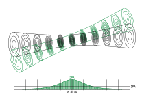

# Pump–Probe Overlap Pen Drawing

A pump and a probe beam, two Gaussian beams crossing in a pump–probe experiment, drawn as a 3-D
contour plot for a pen plotter. Each beam is one pen and one SVG.

**Live page:** https://crestk.github.io/pump-probe-overlap-pen-drawing/

## What it draws

- Each beam is its **1/e² envelope** (the outline of the w(s) surface as the camera sees it)
  plus **slices** across the beam. In each slice, the transverse intensity contours are
  concentric rings.
- By default the rings are fixed fractions of the **focal peak**, so the same ring means the
  same intensity everywhere. The ring count follows the beam: many at the focus, none where the
  beam has spread below the lowest level. You can also put the rings at fractions of **each
  slice's own peak**, so every slice shows the same profile scaled with w(s).
- Under the beams, a panel shows the **2PA and 1PA signal** generated per µm of depth along the
  **z axis**, with a line at every probe slice. 2PA, a pump and a probe photon absorbed
  together, goes as ∫ Ipump·Iprobe dx dy, so it comes only from where the
  beams overlap. 1PA goes as ∫ I dx dy, the beam power, which is the same at every depth. The
  two curves hold the same area (the same total signal), so the panel shows where along z each
  one comes from.
- Line width and **least ring spacing** are set for a Stabilo Point 88 (0.4 mm). Rings closer
  than the line width overlap and shade the bright core. Rings closer than the spacing would
  only pile ink on ink, so they are skipped. The spacing is measured on each ellipse's narrow
  axis.
- The view is orthographic. *Turn* opens the slices into ellipses, *tilt* lifts the camera out
  of the crossing plane, and *transverse stretch* widens lab-sized beams, which are long and
  thin at true proportions.

The probe pen draws the probe beam, the z axis, the slice lines and the 1PA line. The pump pen
draws the pump beam, the 2PA curve and its hatched shading.

## Plotting it

The files are made for [strek](https://mhellevang.github.io/strek/) (Bambu Lab P2S with a pen
module) and work with any tool that reads SVG polylines.

1. Download both SVGs from the page, or take the default pair from `plots/`.
2. Open strek and drop **both files at once**. Each file becomes one pen layer, and layers
   loaded together share one placement, so the colours line up. Layers plot top to bottom; put
   the lighter ink first so the darker lines stay crisp where they cross.
3. Pick the same paper as on the page (A5 landscape by default). The drawing already fits
   inside the margin, so strek plots it at 100% and centres it on the sheet.
4. Download the G-code and run it. The printer pauses after homing for you to mount the first
   pen, and again between layers to swap pens. Don't move the sheet.

If you plot the colours as separate jobs instead, turn on the corner ticks so both files have
the same bounding box.

1 SVG unit is 1 mm, the page is the paper size, and the strokes are plain `<polyline>`s with no
transforms or fills, ordered to keep pen-up travel short. Labels are single-stroke glyphs.

## Command line

`plots/` holds the default drawing: `beam-overlap-probe.svg` and `beam-overlap-pump.svg`, one
per pen, and `beam-overlap-preview.svg`, which has both colours and is only for viewing. To
regenerate it, or make another:

    npm run plot
    node scripts/plot-svg.js --out plots --name wide --set angle=35 --set levels=8

`--set` takes any key of `BeamPlot.DEFAULTS` in `plotter.js` (dotted for the beams, e.g.
`pump.w0=2`).

The page also takes beams in the URL hash, e.g.
`#pl=800&pw=60&rl=530&rw=25&angle=8&L=1000&dx=18&dy=0&dz=0` (pump and probe wavelength in nm
and waist in µm, crossing angle in degrees, sample length and pump offsets in µm). It then draws
them over the sample with a transverse stretch so they read on paper.

## Model

The probe travels along z with its focus at the origin. The pump travels in the x–z plane at
the crossing angle θ, with its focus at (Δx, Δy, Δz). Both are TEM₀₀ Gaussian beams in vacuum:

    I(ρ, s) = I₀ (w₀/w(s))² exp(−2ρ²/w(s)²)
    w(s) = w₀ √(1 + (s/z_R)²),   z_R = π w₀²/λ

A ring at the fraction f of the focal peak sits at ρ² = (w²/2) ln((w₀/w)²/f) in the slice at s.
The 2PA curve is the local overlap ∫ Ipump·Iprobe dx dy from `overlap.js`,
with pulses long next to the walk-off across the crossing.

## Files

- `index.html`, `plot.js`: the page.
- `plotter.js`: the drawing (browser global `BeamPlot`, also a CommonJS module).
- `overlap.js`: the beam model and overlap integrals (browser global `FocalOverlap`).
- `scripts/plot-svg.js`: writes the SVGs from the command line.
- `plots/`: the default drawing.
- `test/`: checks the drawing against the beam model, the SVGs against what strek reads, and
  the overlap integrals against closed forms and brute-force quadrature.

## Tests

    npm test

There is no build step. The page is static, so GitHub Pages serves the repository as it is.
